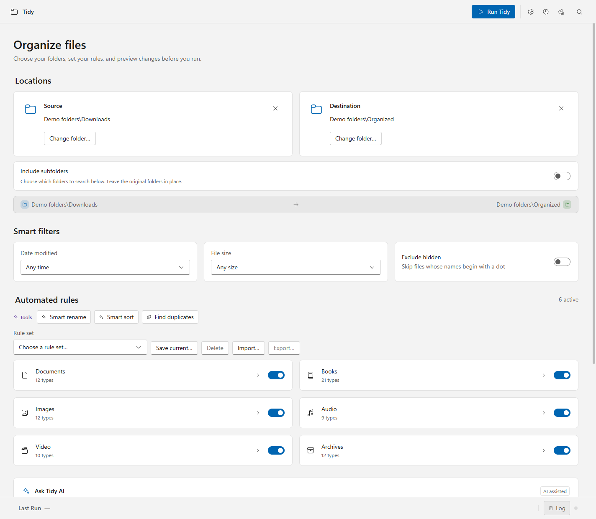
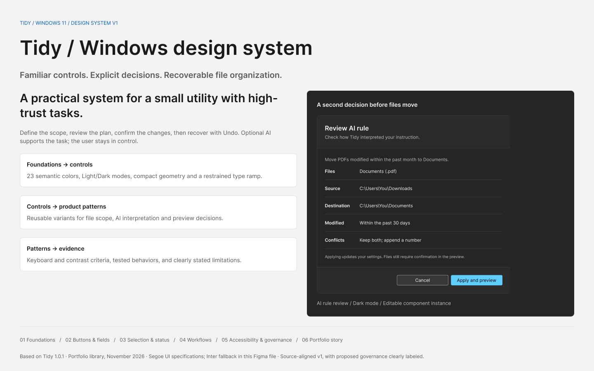
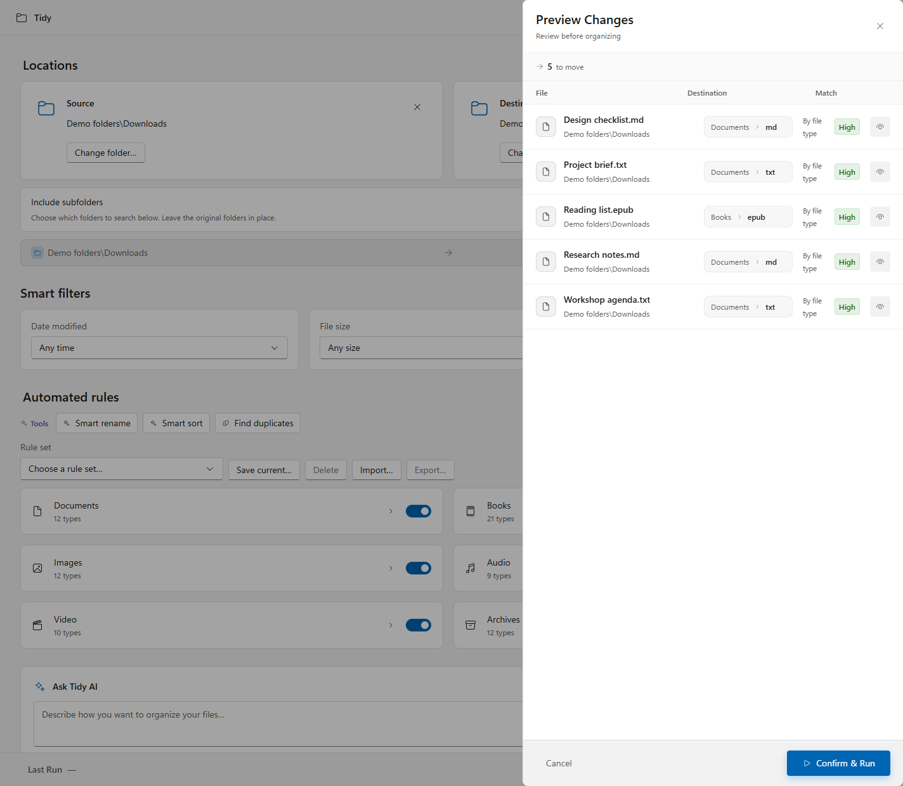
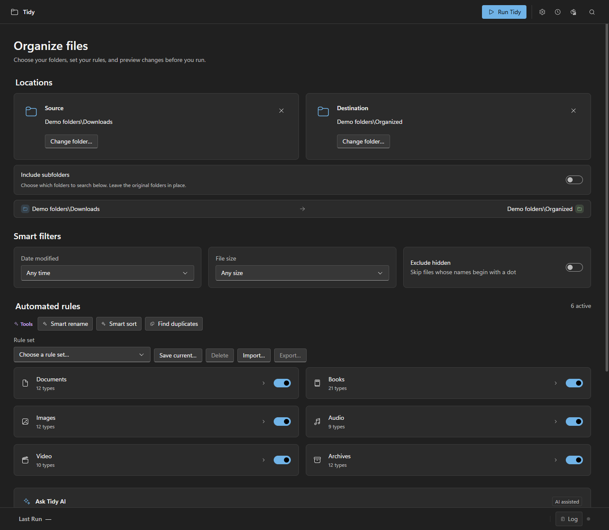
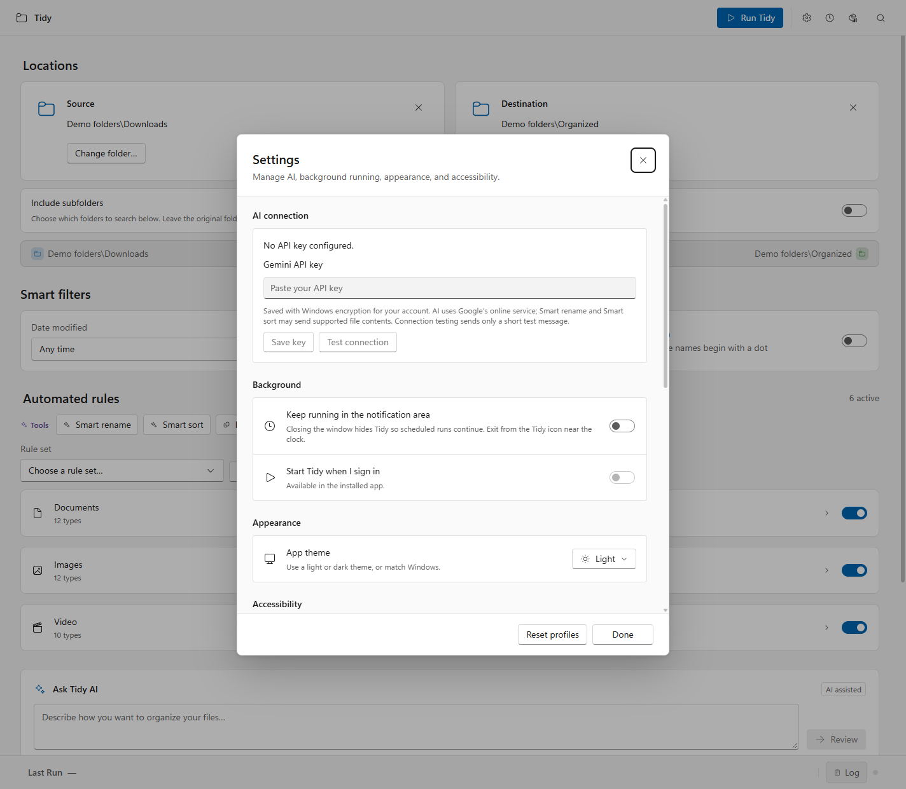

# Tidy — file organization with a moment to review

A Windows desktop app that helps people organize files with visible rules, a preview before changes, and a way to undo them. Designed and built by **Eric Auzenne**, with AI-assisted design and development.

**Windows 11 · Product design · UX/UI · Design systems · Electron + React**



[Design case study](docs/CASE-STUDY.md) · [Design system](design-system/README.md) · [Figma library](https://www.figma.com/design/bgHq8hu5Ik7fiSx3pUi4v3?node-id=0-1) · [Windows guide](docs/WINDOWS.md) · [Development](#run-locally)

**[Download Tidy for Windows](https://github.com/ESm000ve/tidy-windows/releases/latest)** — Windows 11 x64. The installer is unsigned. Core organization works without an API key; add your own Gemini key in Settings for optional AI features.

## The product idea

Tidying a Downloads folder should feel predictable. Automation can save repetitive work, but a wrong rule can move personal documents somewhere unexpected. Tidy makes the scope visible and keeps review and recovery within the core workflow.

1. **Choose the scope.** Select source and destination folders, file types, and optional subfolders.
2. **Set the rules.** Use category controls, filters, saved rule sets, or an optional natural-language instruction.
3. **Review the changes.** Inspect destinations and naming suggestions before confirming.
4. **Recover when needed.** Undo a recorded run from the Activity Log, including after restarting.

## Design decisions

| Decision | What it supports |
| --- | --- |
| Separate AI rule review from file preview | Check the interpreted instruction before authorizing file changes. |
| Leave nested-folder collection off by default | Broader scope is explicit, with folder and file-type selections. |
| Show suggestion sources and confidence | Local filename patterns and AI suggestions have distinct attribution. |
| Include Undo in completion and history | Recovery is available alongside the result of an action. |
| Follow Windows conventions | Familiar menus, shortcuts, Segoe typography, Fluent icons, and light/dark themes. |

Read the [case study](docs/CASE-STUDY.md) for context, contribution, trade-offs, evidence, and proposed user research.

## Design system: from foundations to workflow

The design system connects Tidy's visual language to the decisions people make while organizing files. It includes semantic light/dark colors, typography, reusable controls, and patterns for scope, AI review, preview, and recovery.

**[Explore the editable Figma library →](https://www.figma.com/design/bgHq8hu5Ik7fiSx3pUi4v3?node-id=0-1)**

[](https://www.figma.com/design/bgHq8hu5Ik7fiSx3pUi4v3?node-id=0-1)

The library has **7 pages, 11 component families, and 49 variants**, with light/dark color variables, dimensional tokens, text styles, and Fluent icon components. Figma specimens use a documented Inter fallback; the Windows app uses Segoe UI.

| Explore | Included in this repository |
| --- | --- |
| [Design-system guide](design-system/README.md) | Library overview, Figma page links, and the local interactive reference. |
| [Foundations](design-system/exports/foundations.png) · [Components](design-system/exports/components.png) · [Workflow patterns](design-system/exports/patterns.png) | Presentation boards exported from Figma, viewable directly on GitHub. |
| [Tokens](design-system/design-tokens.json) · [CSS variables](design-system/tokens.css) · [Component inventory](design-system/component-inventory.json) | Inspectable foundations and implementation mapping. |
| [System specification](design-system/DESIGN-SYSTEM.md) · [Validation](design-system/VALIDATION.md) | Behavior contracts, accessibility evidence, and documented limits. |

The design-system v1 materials record the original app 1.0.1 baseline. The [current case study](docs/CASE-STUDY.md) and [Windows guide](docs/WINDOWS.md) describe the later product behavior.

## A closer look

### Review before moving files



### A complete dark theme



### Optional AI, configured by each user



These are captures of the working desktop app with synthetic files and an isolated profile. Folder labels are anonymized for presentation. No personal documents or live AI responses appear. Regenerate them with `npm run build:app` and `npm run screenshots`.

## What works today

- Categories for documents, books, images, audio, video, and archives, with selectable extensions.
- Modification-date and size filters, nested-folder selection, and full-content duplicate detection.
- Conflict handling, replacement backups, year/month filing, saved rule sets, and import/export.
- Manual runs, schedules while Tidy is running, and optional watched-folder organization.
- Persistent history of the last 10 runs, per-run Undo, and backup cleanup through the Recycle Bin.
- Optional Gemini rules, descriptive or date-first naming, and local naming fallback without a key.
- Keyboard navigation, accessibility preferences, reduced motion, and Windows contrast-theme support.

The preview shows up to 50 matching files; a confirmed run processes **all** matching files. AI suggestions apply to previewed files. Schedules and watched-folder runs follow saved rules without interactive preview and do not generate Smart Rename suggestions. Undo is limited history, not crash recovery. See the [Windows guide](docs/WINDOWS.md) for details.

## Run locally

Use **Windows 11 x64** and **Node.js 22 or later**. This repository contains the Windows version; macOS and Linux are not verified targets.

```powershell
npm ci
npm run dev
```

The core organizer works without a key. For optional AI, open **Settings → AI connection** (`Ctrl+,`), paste **your own Gemini API key**, select **Save key**, then **Test connection**. Each user supplies their own key. Saved keys are encrypted for the Windows account, stored outside the project, and never returned to the interface. Developers can alternatively copy `.env.example` to `.env` and supply a local key; Settings keys take precedence.

AI uses Google's online service and the user's project quota. Smart Rename and Smart sort may send filenames and supported file contents to Google when enabled. The connection test sends a short test message. Local organization, duplicate checks, and Undo need no AI service. See [privacy and security](SECURITY.md).

## Build a Windows app

```powershell
npm run build:win
```

The installer is generated under `release/`. For a portable local build, use `npm run build:win:unpacked`, then open `release/win-unpacked/Tidy.exe` or `Run Tidy.cmd`. Installers are currently unsigned. Binaries are excluded from Git; distribute a reviewed installer through GitHub Releases separately.

## Verify changes

```powershell
npx playwright install chromium
npm run verify
npm run check:publish -- --history --build
```

Verification includes TypeScript, production build, file safety, desktop workflows, key storage, browser controls, and targeted accessibility checks. Tests use synthetic files and isolated profiles in `.test-artifacts/`. Live AI testing is separate (`npm run test:ai`), requires your key, and may consume quota. Automated accessibility checks do not establish complete WCAG conformance.

## Project structure

```text
src/              React interface, state, shared rules, and styles
electron/         Desktop lifecycle, secure IPC, and file/AI services
scripts/          Verification, screenshots, and Windows packaging
design-system/    Tokens, component reference, Figma exports, and specifications
docs/             Case study, screenshots, platform guide, and archived reviews
installer/        Windows installer hooks
```

Historical reviews in `docs/archive/` describe earlier builds and may reference local artifacts excluded from Git. See [GitHub preparation](docs/GITHUB.md) for publication steps and [the publication review](docs/RELEASE-REVIEW.md) for this pass's results.

## Credits and license

[MIT](LICENSE). Uses React, Electron, Radix, Microsoft Fluent icons, and the Gemini SDK. The [design-system reference](design-system/README.md) includes the editable Figma library and credits. [Contributions](CONTRIBUTING.md) are welcome.
