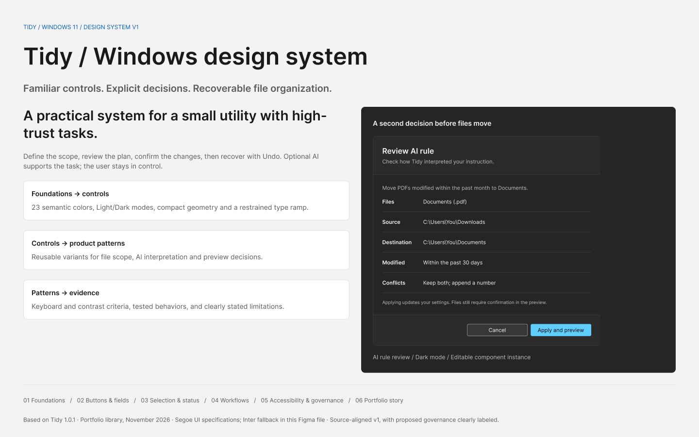

# Tidy / Windows design system

An editable Figma library and implementation reference for Tidy's Windows app. System version **1.0.0** records the app **1.0.1** design baseline. Created November 2026; the [current product case study](../docs/CASE-STUDY.md) covers the later app behavior.

**[Open the Tidy design system in Figma →](https://www.figma.com/design/bgHq8hu5Ik7fiSx3pUi4v3?node-id=0-1)**

## Start here

- Download or clone the repository and open [index.html](index.html) locally for the visual reference, live controls, and a simulated review → preview → confirm → Undo walkthrough. It needs no installation or API key. GitHub shows the HTML source rather than running the reference.
- Read [DESIGN-SYSTEM.md](DESIGN-SYSTEM.md) for the behavior and quality contract.
- Read the [current product case study](../docs/CASE-STUDY.md) or the [design-system case study](PORTFOLIO-CASE-STUDY.md) for rationale and trade-offs.
- Inspect [design-tokens.json](design-tokens.json), [tokens.css](tokens.css), and [component-inventory.json](component-inventory.json) for the implementation mapping.
- Browse [exports/](exports/) for presentation PNGs. Images are flattened presentation assets; the Figma components remain editable.

## Explore the Figma pages

| Page | Figma | GitHub preview |
| --- | --- | --- |
| Start here | [Open overview](https://www.figma.com/design/bgHq8hu5Ik7fiSx3pUi4v3?node-id=0-1) | [Cover](exports/cover.png) |
| Foundations | [Open foundations](https://www.figma.com/design/bgHq8hu5Ik7fiSx3pUi4v3?node-id=2-2) | [Colors, typography, and tokens](exports/foundations.png) |
| Buttons & fields | [Open controls](https://www.figma.com/design/bgHq8hu5Ik7fiSx3pUi4v3?node-id=2-3) | [Component states](exports/components.png) |
| Selection & status | [Open selection](https://www.figma.com/design/bgHq8hu5Ik7fiSx3pUi4v3?node-id=2-4) | [Selection and feedback](exports/selection.png) |
| Workflow patterns | [Open patterns](https://www.figma.com/design/bgHq8hu5Ik7fiSx3pUi4v3?node-id=2-5) | [Scope, review, and recovery](exports/patterns.png) |
| Accessibility & governance | [Open guidance](https://www.figma.com/design/bgHq8hu5Ik7fiSx3pUi4v3?node-id=2-6) | [Accessibility](exports/accessibility.png) |
| Portfolio story | [Open story](https://www.figma.com/design/bgHq8hu5Ik7fiSx3pUi4v3?node-id=2-7) | [Portfolio board](exports/portfolio.png) |

## What is in v1

Seven Figma pages cover the overview, foundations, buttons and fields, selection and status, workflows, accessibility and governance, and portfolio story. There are 11 component families with 49 variants, plus 12 Fluent icon components. Three variable collections contain raw colors, 23 semantic color aliases with Light/Dark modes, and 18 dimensional/motion values. Six text styles include five application roles and one presentation-only display style.

Figma uses **Inter as an editing fallback** because Segoe UI is unavailable in the connected editor. The application and local reference use the Windows Segoe UI stack. Sizes and line heights are aligned; font metrics are not claimed to be identical. Figma preview rows are annotated anatomy specimens rather than exact production-row replicas. Future-only states and governance practices are labeled in the documentation.

## Source of truth

The current application behavior and `src/styles/windows.css` define the implemented baseline. Figma and these documents describe that baseline; they do not modify the app. The proposed contribution process is guidance for future maintenance. No formal usability study, accessibility certification, adoption statistic, or business impact is invented.

## Rebuild the local reference

From the project root, run `node design-system/build-reference.mjs`. This uses Node's built-in filesystem tools and the app's existing source tokens; no new package is required. The HTML, CSS-token export and JSON inventories are generated from the existing stylesheet and this system's inventory.

The `figma-*.js` files are construction records for Figma's plugin runtime, not browser scripts or production app code. The state ledger records exact object IDs for safe continuation. Figma publishing and Code Connect registration are not part of this deliverable.

## Share

Keep this folder together when sharing the local reference. A future public portfolio can host it as static files. Do not include the app's `.env`, personal file paths, API keys, user profiles, test fixtures, or runtime build folders. Nothing in this folder needs a Gemini key.
