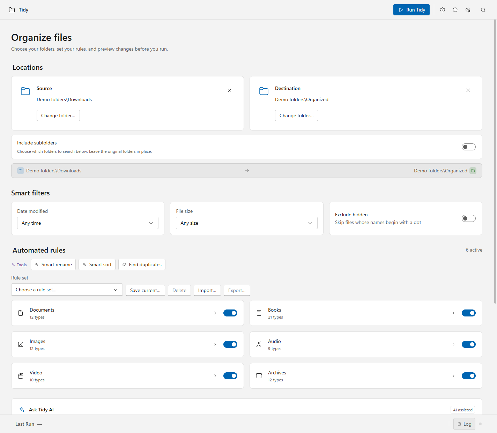
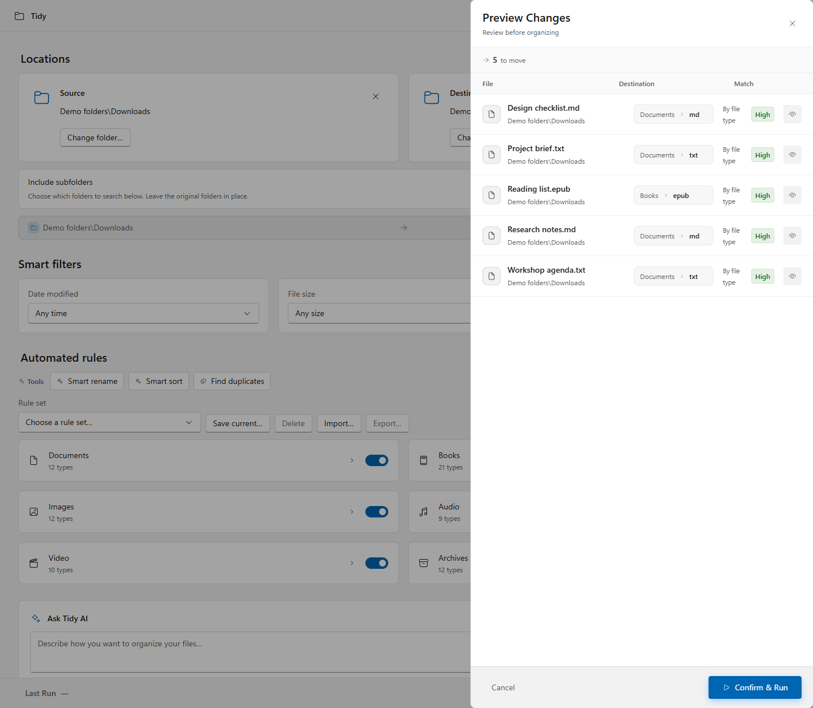
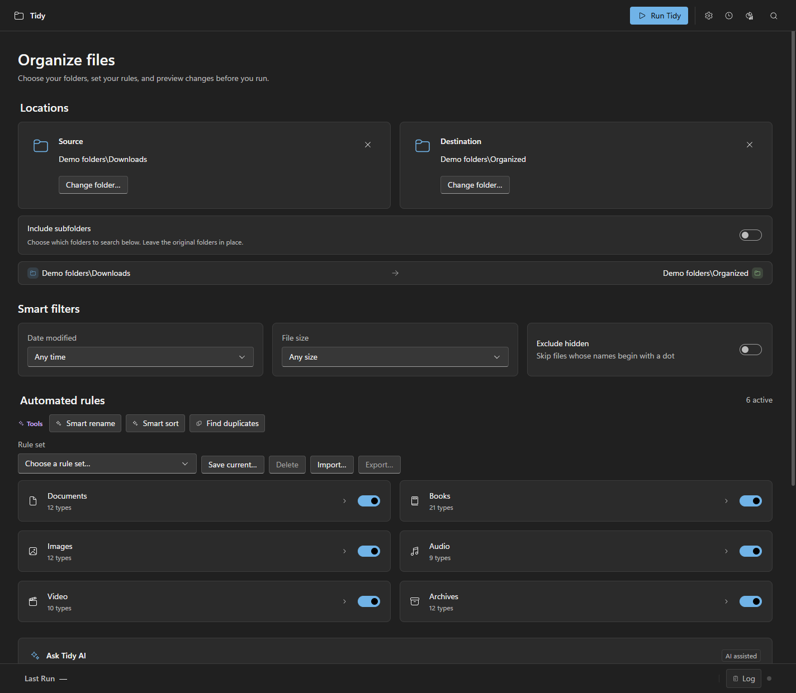
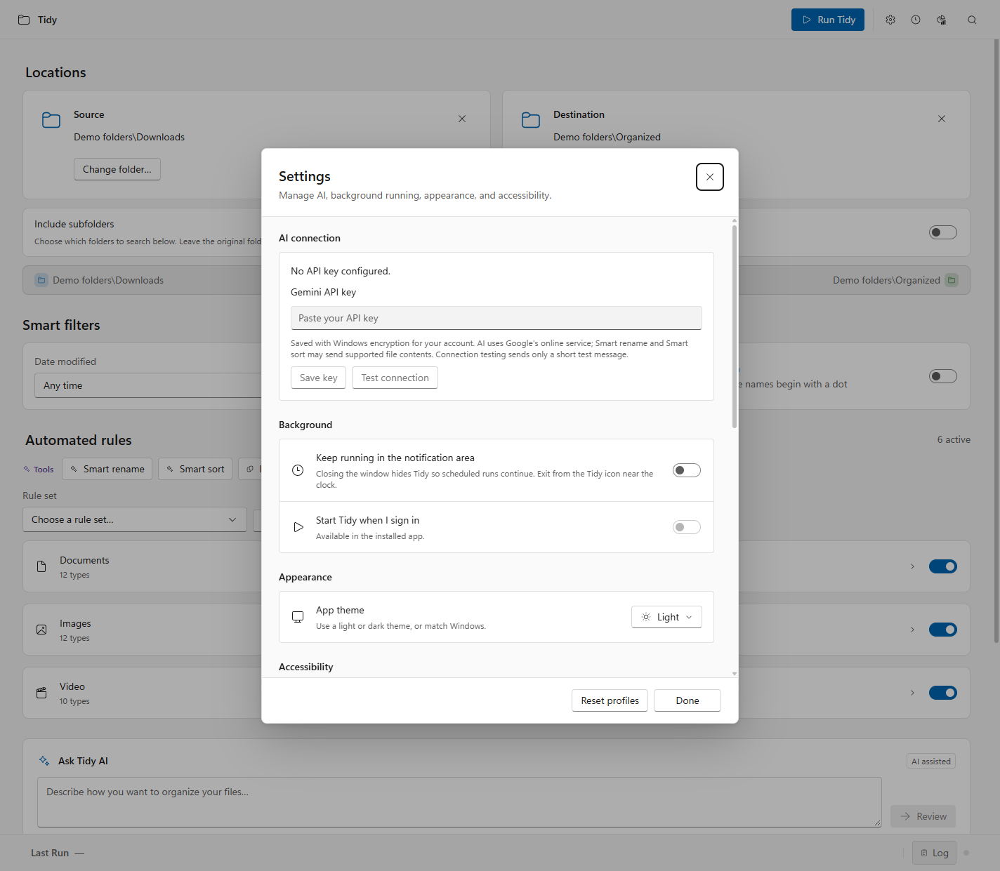

# Tidy: making file automation easier to trust

**Eric Auzenne · Personal product · Windows desktop · Product direction, UX/UI, design-system decisions, and implementation review**

Design and development used AI-assisted collaboration. This case study describes the implemented product and its constraints; it does not claim participant research or measured business impact.

## Context and problem

I made Tidy for myself and my family. The starting point was a repetitive task: taking a folder of mixed downloads and putting files where they belong. The Windows version needed familiar platform behavior while keeping the workflow simple enough to use and maintain.

The central design question was how to make an automated file operation understandable before it changes personal documents. People need to know which files are included, where they will go, and what they can recover afterward.

## My contribution

I set the product direction, shaped the workflow and interface decisions, and reviewed the working implementation with AI assistance. The work includes the Windows UI, explicit source selection, AI review and clarification, preview and recovery, and a design system connecting tokens and components to behavior.

## Make scope an explicit decision

Recursive collection can affect more files than someone expects. Tidy leaves it off by default and reveals folder and file-type choices when enabled. Selection counts make scope visible. Clearing means nothing is selected; it does not silently select everything. Search changes visible options without changing selection.

This adds controls, but keeps a broader operation deliberate. Changing the source resets choices tied to the previous folder.

## Review interpretation separately from execution

An AI response can be structurally valid and still misunderstand the request. Tidy presents a locally generated summary of validated rule changes before applying them. Ambiguous instructions prompt a focused question.

Accepting those rules is followed by the normal preview for an immediate run. The extra step supports a different decision: agreeing to an interpretation versus agreeing to move files. Local naming patterns are labeled separately from AI suggestions, and people can review suggested names before confirming.

## Treat recovery as part of the result

Undo appears in completion and the Activity Log. The app retains the last 10 runs across restarts, including scheduled and watched-folder runs. Replacement preserves the prior file for Undo. A partial Undo retains pending operations, and restoration avoids overwriting a new file at the original location.

The boundaries matter: this is limited history, not crash recovery or a backup product. Scheduled and watched-folder runs also skip interactive review, so they remain optional settings that deserve separate evaluation.

## Build reusable Windows foundations

The visual language uses Segoe UI, Fluent icons, compact controls, layered neutral surfaces, and semantic light/dark colors. Windows conventions informed window behavior, menus, shortcuts, settings, and feedback.

The implementation remains Electron and React, a practical maintenance choice. The [design system](../design-system/README.md) includes tokens, inventories, an editable Figma library, and a local interactive reference. Figma specimens use a documented Inter fallback where Segoe UI is unavailable.

## Privacy as part of setup

The organizer works without AI. People supply their own Gemini key only for online features. Settings explains storage and what can be sent to Google. The key is masked during entry, encrypted for the Windows account, and removable. The repository and installer do not supply an author's key.

## Evidence and limits

Verification exercises moves, duplicate matching, conflicts, replacement backups, nested selections, history, Undo, rule parsing, key storage, and desktop interactions with synthetic data. Targeted accessibility checks cover light/dark states, dialogs, keyboard behavior, reduced motion, zoom, forced colors, and contrast.

These checks support implementation quality. They do not establish full accessibility conformance or demonstrate that people understand scope, confidence, and recovery. [Archived reviews](archive/README.md) preserve earlier evidence; the [publication review](RELEASE-REVIEW.md) records checks from this preparation pass.

## What I would evaluate next

I would observe representative users selecting PDFs from nested folders, declining an incorrect name, recovering a replaced file, and continuing after a partial Undo. I would look at scope errors, completion, recovery success, and confidence interpretation, and test a complete task with assistive technology.

The next design decision is whether the review steps provide enough clarity to justify their effort, and where the interface could explain the next action more simply.

---

Screenshots show the real app with disposable files. Folder labels are anonymized. No live AI outputs, personal documents, or fabricated research results are shown.
